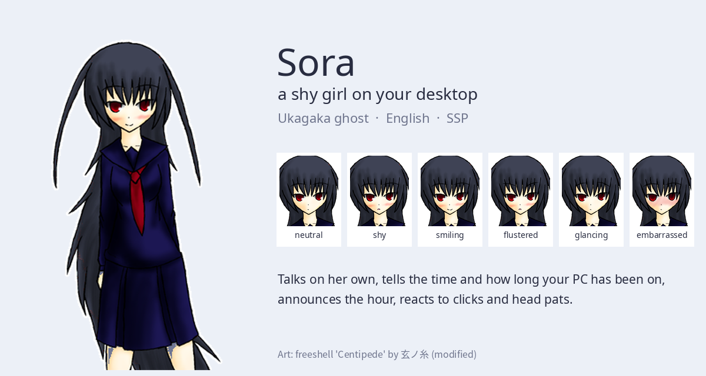

# Sora – a shy girl on your desktop

An English-speaking [Ukagaka](https://en.wikipedia.org/wiki/Ukagaka) ghost for [SSP](http://ssp.shillest.net/).



## What she does

- Greets you depending on the time of day and says goodbye when you close her
- Tells you the date, the time and how long your PC has been running
- Talks on her own every few minutes (you can change how often, or silence her)
- Announces the hour, with special lines at midnight and noon
- Shy reactions when you double-click her head, face or chest
- Likes head pats: rest the mouse on her head for a while
- Double-click anywhere else on her for a small menu
- Asks your name the first time and remembers it

## Install

1. Download and start [SSP](http://ssp.shillest.net/).
2. Download `sora.nar` from the [latest release](../../releases/latest).
3. Drag `sora.nar` onto any character on your desktop and confirm.

### Linux

SSP runs under Wine. You need an X11 session and a compositor for transparency
(on XFCE: *Window Manager Tweaks → Compositor*). If Japanese text in SSP's menus
shows up as boxes, map the Japanese Windows fonts to a CJK font such as
Noto Sans CJK JP under `HKCU\Software\Wine\Fonts\Replacements`.

## Building the .nar yourself

A `.nar` is a plain zip of the ghost folder:

```sh
cd sora && zip -r -X ../sora.nar .
```

The dialogue lives in `sora/ghost/master/sora_*.dic` (YAYA script), so it is easy
to add your own lines.

## Credits

- **Character art:** freeshell 「Centipede」 by 玄ノ糸 (BlackStrings) –
  <http://anotherblack.soragoto.net/>. Modified: converted to alpha PNG and the red
  centipede streaks recolored to match her hair. The original terms are in
  `sora/shell/master/readme_original.txt` (modification is free; commercial use
  needs the author's consent; don't claim to be the author).
- **SHIORI:** [YAYA](https://github.com/YAYA-shiori/yaya-shiori) by 整備班 (SEIBIHAN),
  BSD 3-Clause – see `sora/ghost/master/LICENSE_YAYA.txt`.
- **Ghost (dialogue and scripts):** Vulture

Inspired by a request on r/MoeDesktop for the mascot in an old screenshot.
